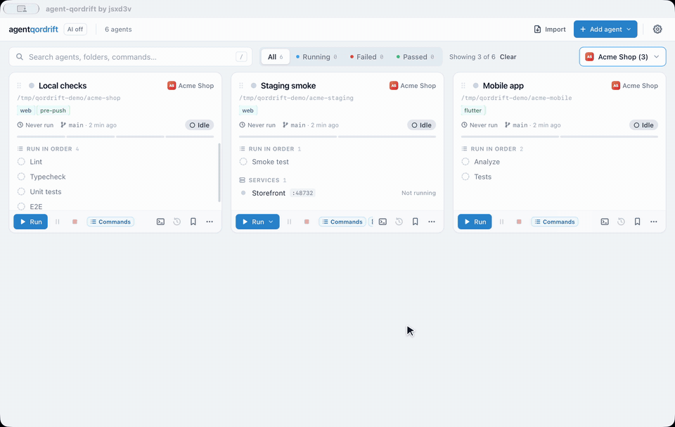

# agent-qordrift

**Run each project's checks — lint, typecheck, unit tests, E2E, builds — from one dashboard of cards.**
Click **Run**, watch live logs, and get a clear **Success** or **Failed at step N**. Free for macOS and Windows.

Optional: add your own Claude or OpenAI API key and agent-qordrift explains failures for you — what failed, where,
and how to fix it.



<sub>[Watch the demo as a video](screenshots/demo.mp4) · the projects in the demo are sample data.</sub>

## Download

Get the latest version from [**Releases**](../../releases/latest):

| System | File |
|---|---|
| macOS 11 or later (Apple Silicon and Intel) | `agent-qordrift_<version>_universal.dmg` |
| Windows 10 (1809+) / 11 | `agent-qordrift_<version>_x64_en-US.msi` or `agent-qordrift_<version>_x64-setup.exe` |

## Install

agent-qordrift is free and not yet signed with a paid Apple or Microsoft certificate, so your system asks you to
confirm the first time you open it.

### macOS

1. Open the `.dmg` and drag **agent-qordrift** to **Applications**.
2. Open agent-qordrift. macOS says it can't verify the developer. Click **Done**.
3. Open **System Settings → Privacy & Security**, scroll down and click **Open Anyway** next to the message
   about agent-qordrift, then confirm. (On macOS 15 and later, right-click → Open no longer skips this step.)
4. If macOS says the app **"is damaged and can't be opened"**, run this once in Terminal, then open it again:

   ```bash
   xattr -dr com.apple.quarantine /Applications/agent-qordrift.app
   ```

**Keychain prompt (only with an AI key):** your API key is kept in the macOS Keychain. Until agent-qordrift has an Apple
Developer ID, macOS may ask "agent-qordrift wants to use your keychain" after each update. Choose **Always Allow**.

### Windows

1. Run the `.msi` or `-setup.exe`.
2. If Windows SmartScreen says "Windows protected your PC", click **More info → Run anyway**.
3. The installer adds Microsoft Edge WebView2 if it is missing (most Windows 10/11 PCs already have it).

## Quick start

1. Click **Add your first agent** (or **Import example**).
2. Pick a project (it groups agents, e.g. "Shop" with a "Local" and a "Staging" agent), the agent's folder, and
   add steps, one command each:

   ```yaml
   name: My app
   path: ~/code/my-app
   steps:
     - name: Lint
       run: npm run lint
     - name: Unit tests
       run: npm test
     - name: E2E
       dir: web
       run: npm run e2e
       timeout: 20m
   ```

3. Click **Run**. Steps run in order and stop at the first failure.

Steps run with your normal shell environment (nvm, pyenv, Homebrew, Go…), even when agent-qordrift is opened from the
Dock or the Start menu. On Windows, steps run with `cmd.exe` (PowerShell 7 is an option in Settings).

## Two modes

| | **AI off** (default, no key) | **AI on** (your AI key) |
|---|---|---|
| Set up | Nothing | Settings → AI → Claude or OpenAI → paste key → Test key |
| Steps, logs, Pause/Stop, history, notifications | ✅ | ✅ |
| When a step fails | "Failed at step N" + the log | The same, plus a short AI analysis: cause, where, fix |
| Network use by the app | None (only the optional update check) | Provider calls for failed runs only |
| Cost | Free | Free app; you pay your provider for your own API usage |

Works with Claude (Anthropic) and OpenAI models. agent-qordrift is not affiliated with or endorsed by either.

## Features

- **Projects and Home:** group agents by project, with a logo; Home shows one tile per project with how its last
  runs went. Bookmarks keep each project's links (staging site, dashboard, docs) one click away.
- **Agents as cards:** folder, ordered steps, per-step folder and timeout, environment variables and secrets (kept
  in the system keychain), tags, success message.
- **Database checks:** run a SQL query against Postgres or Supabase (with `psql`) and report the result, or expect rows or no rows.
- **Schedules:** run an agent once at a set time, every few minutes, hours or days, or on chosen weekdays.
- **Services:** start a dev server before the steps, wait until a port, URL or log line is ready, stop it after.
  A port that is already in use fails the run instead of testing an old server.
- **Pause, Resume, Stop:** pause after the current step (or immediately on macOS); Stop ends the whole process tree.
- **Run all:** one after another (default) or in parallel.
- **Live logs with colors**, search, copy, and per-step tabs; history of the last 50 runs with git branch and commit.
- **Notifications and tray icon** with the overall status.
- **Agent editor** with a YAML mode and validation; import/export agents as `.yaml` files (imported agents show
  their commands and ask before the first run).

## Privacy

No accounts, no telemetry, no analytics. Your agents, logs and history stay on your computer. With AI on, only a
masked excerpt of a failed step's log is sent, to the provider you chose, with your key. API keys are kept only in
your system keychain. Read the full [privacy statement](PRIVACY.md).

## Updates

agent-qordrift checks this repository for new versions at startup (you can turn this off in **Settings → Updates**) and
installs them with one click. Updates are signed and verified before they are installed. See the
[changelog](CHANGELOG.md).

## License

agent-qordrift is free for personal and commercial use under the [agent-qordrift freeware license](LICENSE): no
redistribution, modification or reverse engineering; provided "as is", without warranty. You are responsible for
the commands you configure. It includes open-source software listed in [THIRD_PARTY_NOTICES.md](THIRD_PARTY_NOTICES.md).

## Feedback

Found a bug or have an idea? [Open an issue](../../issues). Security issues: please use
[private vulnerability reporting](../../security/advisories/new) instead.

## Support

agent-qordrift is free. If it saves you time, you can support it with a donation from **Settings → Donate** or
[paypal.me/jsxd3v](https://paypal.me/jsxd3v). Donations are voluntary and don't buy support, features or other
rights.
